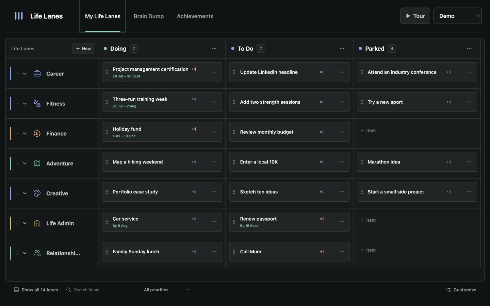

# Life Lanes

Life Lanes is a calm personal board for the things that compete for space in your head.



Capture a loose thought like a note, then place it where two questions meet:

- **What part of life is this?** Career, Fitness, Finance, Relationships, Creative, or any Life Lane you create.
- **Where is it now?** Doing, To Do, Parked, or any state that suits the way you think.

The result is a life map with the ease of a notes app and just enough structure to make priorities visible.

## The Three Views

### My Life Lanes

A compact matrix with states across the top and Life Lanes down the side. Notes can be reordered or moved between any intersection with drag and drop. On mobile, one state is shown at a time so the board stays focused.

### Brain Dump

A low-friction place for unfinished thoughts. Capture first, then use Triage to choose the right state and Life Lane when you are ready.

### Achievements

A separate record of completed items, grouped by Life Lane. Completing an item clears it from the active board without throwing away the progress it represents.

## Highlights

- Blank personal board and a realistic, interactive demo
- Separate personal and demo data with no crossover
- Smooth pointer, touch, and keyboard-friendly drag and drop
- Two-level arrow-key navigation across views, states, and items
- Custom Life Lanes and custom board states
- Optional date ranges for longer goals
- Search by item, note, or Life Lane, with a compact priority filter
- Quick completion with undo and a small celebratory flourish
- Previewed JSON import with merge or replace options
- Recovery-aware browser persistence and cross-tab syncing
- Responsive layout designed for phone and desktop
- Installable offline shell
- No account, backend, analytics, or AI API

## Privacy

Life Lanes stores the personal board in the browser. Nothing is sent to a server. Browser storage is not encrypted, so anyone with access to the same browser profile can open the board.

The Demo is temporary and separate from personal data. Refreshing it gives you a clean example board without changing your own Life Lanes.

Export creates a portable backup. Import previews its contents first, and replacing a board keeps a recovery copy of the previous state.

## Run It

```bash
npm install
npm run dev
```

Open the local address shown in the terminal.

To verify a production build:

```bash
npm run build
```

The repository also includes desktop and mobile journey tests plus an offline-shell check:

```bash
npm run test:e2e
npm run test:pwa
```

## Built With

React, TypeScript, Vite, dnd-kit, Playwright, Lucide icons, localStorage, and focused custom CSS.

## License

[MIT](LICENSE)
