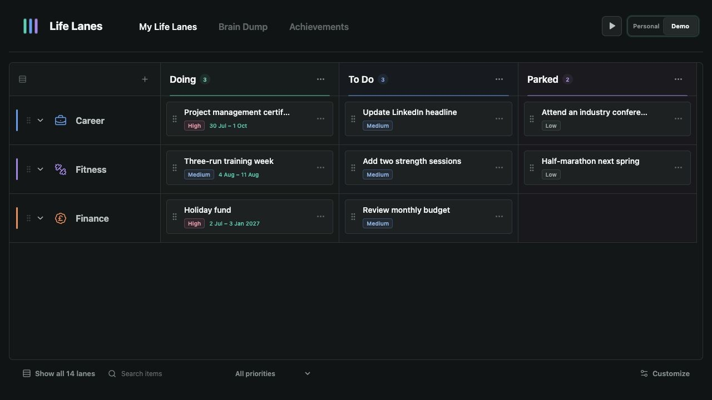

# Life Lanes

Life Lanes is a calm, visual way to organise the different parts of your life.

Instead of putting everything into one long to-do list, you can give areas such as career, health, finances, relationships, and home their own lane. Each lane shows what you are doing, what is next, and what can wait.

**[Try Life Lanes](https://georgemorden.github.io/LifeLanes/)**

## The idea

Life is made up of several things that matter at once. Life Lanes helps you see them together without making them feel like one overwhelming project.

- Capture loose thoughts in **Brain Dump**.
- Move useful ideas into the right **Life Lane**.
- Organise items by simple states such as **Doing**, **To Do**, and **Parked**.
- Mark finished work as an **Achievement**, or bring it back when plans change.
- Use the separate **Demo** to explore the product without touching your own board.

Your personal board starts blank and stays in your browser. There is no account to create, and your data is not sent to a server. You can export a backup whenever you want to keep a copy or move your board elsewhere.
